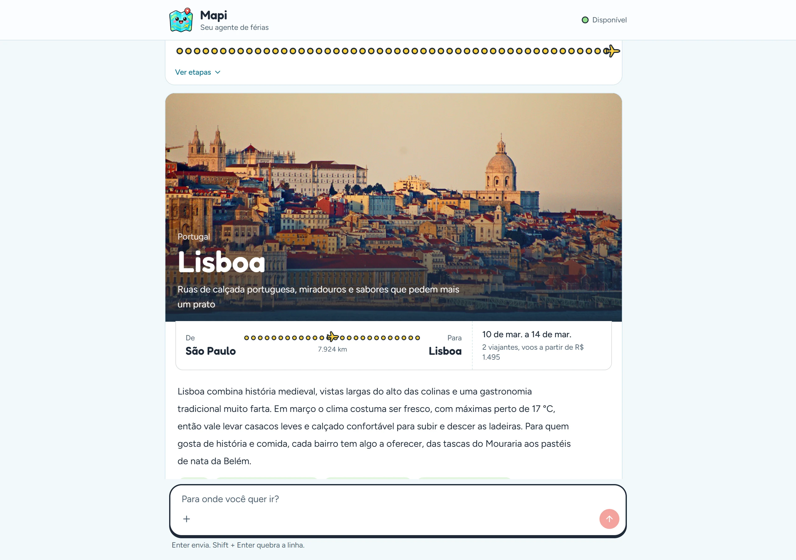
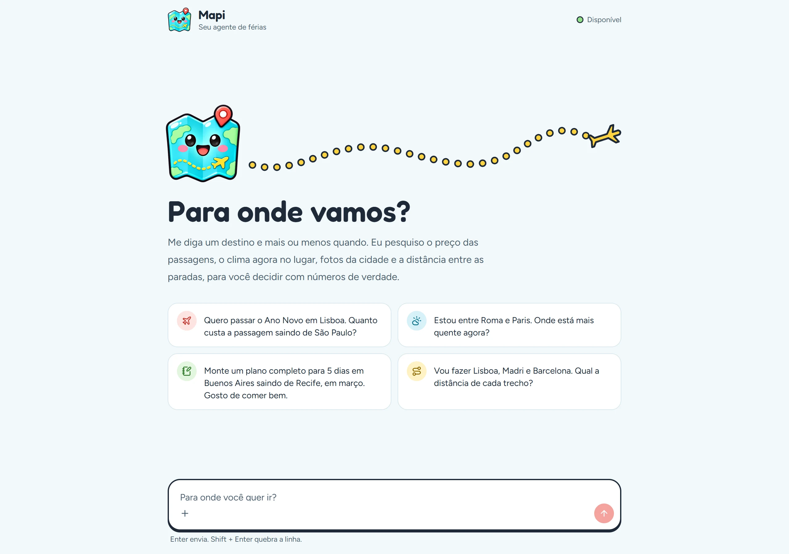
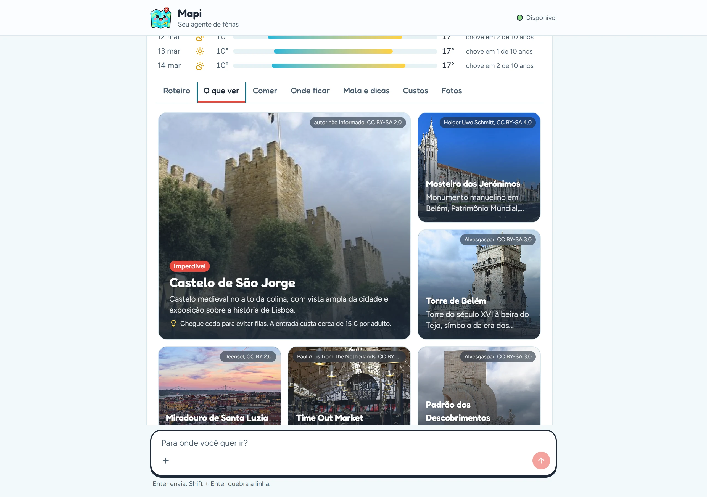
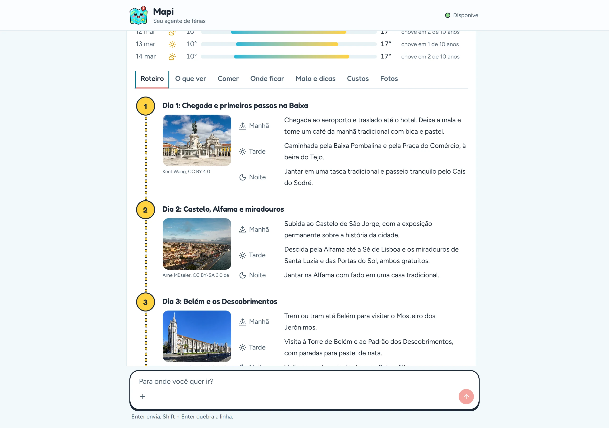

<p align="center"></p>

# Mapi: agente pessoal de planejamento de férias

[English](README.md) | **Português**



| Tela inicial | Atrações em bento grid | Roteiro dia a dia |
| --- | --- | --- |
|  |  |  |

Agente que demonstra, na própria implementação, os conceitos de agentes de IA: chamada à Messages API, definição de ferramentas com JSON Schema, execução local de `tool_use`, loop agêntico, limite de passos, guardrail de escopo e UI gerada pelo agente. O servidor usa Hono, a interface é um cliente React com componentes do [Agents Kit](https://agents-ui.github.io/agents-kit/) e Tailwind CSS 4, e as respostas chegam por WebSocket.

## Persona e interface

O agente se apresenta como **Mapi**, um agente pessoal que ajuda a planejar férias: preço de passagens, clima agora no destino, fotos da cidade, distância entre as paradas e as contas do orçamento. A persona está no prompt de sistema (`src/agents/agent.ts`); o guardrail aceita cumprimentos, para que Mapi possa se apresentar.

A identidade visual sai do mascote (`public/brand/mapi.png`, também usado como favicon):

- **Cores**: o contorno escuro do mascote (`--ink`), o azul do mapa (`--lagoon`), o verde das ilhas (`--island`), o vermelho do pino (`--pin`, botão de enviar e cidades no mapa) e o amarelo da rota (`--route`). Os tokens ficam em `src/client/styles/globals.css` e `agents.css`.
- **Tipografia**: Fredoka (arredondada, como o adesivo do mascote) nos títulos e no nome do agente; Figtree no texto.
- **Rota pontilhada**: na tela inicial, uma rota amarela sai do mascote até um avião e é desenhada uma vez ao carregar (sem animação com `prefers-reduced-motion`). As rotas do mapa de distâncias usam o mesmo traço.
- **Compositor**: contorno grosso e sombra sólida, como o adesivo, e o botão de enviar na cor do pino.

- **Conversa**: `MessageScroller`, `Message` e `MessageBubble`. Cada pergunta forma um turno com a atividade do agente, a UI gerada e a resposta.
- **Atividade do agente**: `AgentActivity` mostra o pensamento e cada chamada de ferramenta enquanto o agente trabalha, e recolhe num resumo quando termina.
- **Compositor**: `PromptInput`, com altura automática, Enter para enviar e Shift + Enter para nova linha, menu "+" com modelos de pergunta, contador perto do limite de caracteres e botão **Parar**, que cancela a execução no servidor.

Os componentes do kit são copiados para `src/client/components/beui/` (licença MIT, ver `LICENSE` e `SOURCE.json` na pasta), como o kit recomenda. Esse código de terceiros não foi escrito para a opção `exactOptionalPropertyTypes`, por isso ela fica desligada só no `tsconfig.client.json`. As demais regras estritas continuam ativas.

## Requisitos

- Node.js 22.9 ou superior (o projeto foi testado com Node 24)

## Instalação

```powershell
npm install
Copy-Item .env.example .env
```

Preencha o `.env` com o provedor escolhido.

## Execução

```powershell
npm start
```

O comando gera o bundle do cliente (`public/build`) e sobe o servidor. Depois abra [http://localhost:3000](http://localhost:3000) no navegador. Para usar outra porta, defina `PORT` no `.env`.

Para gerar só o bundle do cliente:

```powershell
npm run build:client
```

## Configuração

| Variável | Função | Padrão |
| --- | --- | --- |
| `ANTHROPIC_PROVIDER` | `anthropic` ou `bedrock` | `anthropic` |
| `ANTHROPIC_API_KEY` | Chave da API direta | obrigatória no provedor `anthropic` |
| `AWS_REGION` | Região do Bedrock | obrigatória no provedor `bedrock` |
| `AWS_BEARER_TOKEN_BEDROCK` | Token do Bedrock | cadeia padrão da AWS, se ausente |
| `ANTHROPIC_MODEL` | Modelo usado | `claude-haiku-5-5` ou `global.anthropic.claude-haiku-5-5` |
| `AGENT_MAX_STEPS` | Limite de passos do loop | `8` |
| `PORT` | Porta do servidor HTTP e WebSocket | `3000` |
| `TAVILY` | Chave da API Tavily, usada na busca de passagens | sem chave, a ferramenta `search_flights` responde com erro |
| `WIKIMEDIA_CONTACT` | E-mail ou site enviado no User-Agent às APIs da Wikimedia | sem contato (limite de 10 requisições por minuto) |

## Arquitetura

O agente roda no servidor, para que as chaves de API nunca cheguem ao navegador. O navegador envia cada pergunta por WebSocket e recebe, na mesma conexão, os eventos do agente (pensamento, chamadas de ferramenta, resultados, guardrail e UI gerada) e a resposta final.

Cada conexão WebSocket tem a sua própria conversa.

### UI gerada pelo agente

O agente tem uma ferramenta de apresentação, `render_ui`. Quando a resposta tem dados estruturados, o modelo a chama com uma especificação de interface em JSON, que o servidor valida com `zod` e envia ao navegador como um evento `ui`. O cliente renderiza a especificação com Tailwind e os tokens do kit; abas, accordion e medidor usam os componentes headless do [UI SDK](https://ui-sdk.dev/docs) para o comportamento e a acessibilidade.

Blocos disponíveis:

| Bloco | Renderização |
| --- | --- |
| `text` | parágrafo |
| `stats` | cartões de indicadores |
| `table` | tabela |
| `list` | lista |
| `meter` | `Meter` do UI SDK |
| `tabs` | `Tabs` do UI SDK, com blocos simples em cada aba |
| `accordion` | `Accordion` do UI SDK, com blocos simples em cada seção |

O modelo não gera código: ele só preenche essa especificação, e o cliente decide como desenhá-la.

### Mapa de distâncias

As ferramentas também podem anexar UI ao próprio resultado. A `calculate_distance` anexa um bloco `map` com as cidades e a rota geodésica de cada par, calculada no servidor (elipsoide WGS84, `geographiclib`). O cliente desenha o mapa com Leaflet e tiles do OpenStreetMap, com a distância de cada trecho sobre a linha.

O bloco `map` não faz parte da especificação que o modelo preenche: as coordenadas vêm da geocodificação, e não do modelo. Rotas que cruzam o antimeridiano (por exemplo, sobre o Pacífico) são desenhadas nas duas bordas do mapa, para ficarem ligadas aos dois marcadores.

Os tiles do OpenStreetMap seguem a [política de uso](https://operations.osmfoundation.org/policies/tiles/) da OSM Foundation: servem para demonstração, mas não para tráfego alto. Em produção, use um provedor de tiles próprio ou contratado.

### Fotos de cidades

A ferramenta `get_city_photos` busca fotos de uma cidade sem chave de API:

1. A geocodificação da Open-Meteo devolve o ID GeoNames da cidade.
2. Uma consulta SPARQL à Wikidata encontra a cidade por esse ID (propriedade `P1566`) e devolve a imagem principal (`P18`) e o título do artigo na Wikipedia em português ou inglês.
3. A API da Wikipedia lista as fotos do artigo, na ordem em que aparecem.
4. A API do Wikimedia Commons devolve a miniatura, a descrição, o autor e a licença de cada foto.

Buscar pelo ID GeoNames garante que as fotos são da mesma cidade que a geocodificação encontrou. A ferramenta anexa um bloco `gallery`, que o cliente mostra como uma galeria com miniaturas, navegação por setas e o crédito de cada foto, com link para a página dela no Commons. As fotos têm licenças livres, como CC BY-SA, que exigem esse crédito.

As APIs da Wikimedia limitam clientes sem contato no User-Agent a 10 requisições por minuto, e cada cidade usa até três. Para subir o limite para 200, defina `WIKIMEDIA_CONTACT` no `.env`. O servidor também guarda em memória as fotos de cada cidade já consultada.

### Previsão do tempo para um período

A ferramenta `get_forecast` responde como vai estar o tempo em uma cidade num período de até 31 dias, sem chave de API:

- **Até 16 dias à frente**: previsão diária da Open-Meteo (máxima, mínima, chance de chuva e condição do céu).
- **Depois disso**: média histórica das mesmas datas nos últimos 10 anos, calculada a partir da API de arquivo da Open-Meteo (`archive-api.open-meteo.com`) numa única requisição. Inclui as máximas e mínimas médias, a parcela de dias com pelo menos 1 mm de chuva e a chuva média por dia.

Quando o período cruza o limite de 16 dias, a resposta mistura as duas coisas. O bloco `weather_outlook` mostra a previsão em cartões por dia e a média histórica com indicadores, uma barra de mínima e máxima por dia, quantos anos choveu naquela data e um ícone do tempo típico (chuva quando choveu em 4 ou mais dos 10 anos, sol quando choveu em 1 ou menos, variável nos demais casos). O texto deixa claro que a média é o clima típico, não uma previsão. `get_weather` continua respondendo só a temperatura de agora.

### Busca de passagens

A ferramenta `search_flights` pesquisa passagens aéreas entre duas cidades, com datas de ida e volta opcionais. Ela monta uma consulta em português e chama a API de busca da [Tavily](https://tavily.com) com a chave definida em `TAVILY`. O resultado são páginas de companhias aéreas e comparadores, com o preço citado em cada uma, quando houver.

Os resultados são ordenados pela rota: primeiro as páginas cujo título cita origem e destino nessa ordem, depois as que citam só o destino, depois as genéricas. Páginas da rota invertida ficam por último. O preço só é extraído quando o título cita o destino, para não exibir o preço de outra rota.

Não existe API aberta de cotação de passagens, e a gratuita da Amadeus foi encerrada em 2026. Por isso a ferramenta busca na web: os preços são referências encontradas em páginas, que podem estar desatualizadas, e não cotações em tempo real. O agente avisa isso na resposta, e o cliente mostra os resultados como uma lista de links (bloco `web_results`) com o preço citado e o mesmo aviso.

O agente recebe a data de hoje no prompt de sistema, para converter pedidos como "em dezembro" em datas.

### Plano de viagem completo

A ferramenta `plan_trip` monta um plano inteiro para um destino (origem, datas, número de viajantes e interesses são opcionais). Ela é a demonstração de uma ferramenta que orquestra outras etapas e usa o próprio modelo:

1. **Pesquisa em paralelo**: localiza o destino e a origem (Open-Meteo), busca o clima atual e o tempo nas datas da viagem (previsão até 16 dias à frente, média histórica depois disso, como em `get_forecast`; sem datas, a previsão dos próximos 7 dias), fotos (Wikimedia), passagens e distância geodésica, e faz seis buscas na web com a Tavily: o que ver, o que comer, onde ficar, dicas práticas, eventos no período e orçamento diário.
2. **Composição**: envia a pesquisa ao modelo com uma chamada forçada à ferramenta interna `compose_trip_plan`, cujo esquema `zod` define o plano (roteiro dia a dia, atrações, comida, bairros, dicas, eventos, orçamento e itens para a mala). A resposta é validada antes de ser exibida.
3. **Dados calculados no código**: a diferença de fuso em relação a Brasília (a partir do fuso do destino) e o menor preço de passagem não vêm do modelo, para evitar erros.
4. **Fotos do roteiro, atrações, pratos e bairros**: o modelo informa, para cada item (e para o lugar principal de cada dia do roteiro), o título do artigo na Wikipedia em inglês. Uma única requisição busca a imagem principal de todos os artigos (com até cinco buscas extras para títulos que não existem) e outra traz autor e licença no Wikimedia Commons. As abas "O que ver", "Comer" e "Onde ficar" mostram os itens num bento grid (`trip-plan/bento.tsx`): o primeiro item, o mais importante, ocupa um bloco grande e os demais preenchem a grade de seis colunas sem deixar buracos. A foto cobre cada bloco, com o texto sobre um degradê e o crédito (autor e licença, com link para a imagem) no canto. Itens sem foto usam um bloco colorido com ícone. No celular, a grade vira uma coluna. No roteiro, cada dia mostra uma foto pequena do seu lugar principal à esquerda da programação de manhã, tarde e noite.

Enquanto a ferramenta roda, ela envia eventos `progress` pelo WebSocket. O cliente mostra uma lista de etapas que vai sendo marcada, com um avião que avança pela rota pontilhada. No fim, o bloco `trip_plan` mostra a foto de capa, um bilhete com origem, destino, datas e passagem mais barata, informações rápidas, a previsão e abas com roteiro, atrações, comida, bairros, dicas com lista de mala, custos e fotos, além das fontes pesquisadas.

As ferramentas recebem um contexto (`ToolContext`) com o cliente do modelo, o sinal de cancelamento e a função para relatar progresso. O botão **Parar** também interrompe as buscas e a composição do plano.

Cada plano usa cerca de sete buscas da Tavily e uma chamada extra ao modelo, e leva em torno de 20 segundos.

### Formulário de período e viajantes

Antes de `plan_trip` ou `search_flights`, o agente confere se já sabe as datas de ida e volta e quantas pessoas vão viajar. Se faltar algo, ele chama `request_trip_details` (`src/agents/forms/`), preenchendo o que já sabe (origem, destino, interesses), e o chat mostra um formulário com:

- origem e destino;
- calendário de período: dois meses no desktop e um no celular, intervalo destacado com prévia ao passar o mouse, navegação pelas setas do teclado e datas passadas bloqueadas;
- número de adultos e crianças;
- interesses, para o plano, ou "Só ida", para passagens.

Essa ferramenta **pausa o agente**: o loop termina sem nova chamada ao modelo, e a conversa fica parada no resultado da ferramenta. Ao enviar o formulário, o cliente manda uma mensagem completa ("Monte o plano completo de viagem para Lisboa saindo de São Paulo, com ida em 10/12/2026 e volta em 16/12/2026, para 2 pessoas…"), que o servidor junta à mensagem pausada. O agente então roda as ferramentas correspondentes.

### Próximo passo com Sim e Não

Quando a resposta termina oferecendo uma ação, como "Quer que eu refaça o plano com 5 dias?", o cliente mostra os botões **Sim** e **Não** logo abaixo.

Depois de cada resposta que contém uma pergunta ou uma oferta ("se quiser", "posso", "quer que eu"), o servidor faz uma chamada curta ao modelo (`src/agents/decisions/next-step.ts`), com saída forçada numa ferramenta e validada com `zod`. Essa chamada decide se há uma oferta concreta que as ferramentas conseguem executar e devolve:

- `question`: a pergunta de sim ou não;
- `confirmPrompt`: o pedido completo que o usuário faria ao aceitar, com cidades, datas e detalhes, para o agente não depender de reler a conversa.

Não aparecem botões quando a pergunta é aberta ("para onde você quer ir?") ou quando a oferta depende de algo que só o usuário sabe, como as datas. **Sim** envia o `confirmPrompt` como uma nova mensagem, que passa pelo guardrail normalmente. **Não** só fecha os botões, sem nova chamada. Os botões aparecem apenas na última resposta.

### Protocolo WebSocket (`/ws`)

Mensagens do navegador para o servidor:

```json
{ "type": "prompt", "text": "Qual a temperatura em Lisboa?" }
{ "type": "cancel" }
```

Mensagens do servidor para o navegador:

- `ready`: configuração ativa (provedor, modelo, limite de passos e tamanho máximo da pergunta).
- `event`: evento do agente (`thinking`, `tool`, `result`, `guardrail`, `ui` ou `progress`).
- `answer`: resposta final, com `blocked`, `stoppedByLimit` e `nextStep` (a oferta de sim ou não, quando houver).
- `cancelled`: a execução foi interrompida por um `cancel`. O histórico da conversa volta ao estado anterior à pergunta.
- `error`: erro, incluindo mensagem inválida ou envio enquanto outra resposta está em andamento.

## Estrutura

```
src/
  index.ts                  ponto de entrada: lê a configuração e inicia o servidor
  agents/                   lógica do agente, sem nenhuma dependência de interface
    agent.ts                loop agêntico com limite de passos
    chat.ts                 sessão de conversa (histórico, contexto e guardrail)
    client.ts               criação do cliente (API direta ou Bedrock)
    config.ts               leitura e validação das variáveis de ambiente
    types.ts                tipos do agente
    context/                contexto da conversa como entidades (cidades e turnos)
    decisions/              extrai da resposta o próximo passo de sim ou não
    forms/                  ferramenta que pede período e viajantes e pausa o agente
    generative-ui/          especificação de UI (zod), tipos e ferramenta render_ui
    guardrails/
      scope.ts              classificador de escopo (só responde sobre as tools)
    planner/                plano de viagem: pesquisa, composição com o modelo, progresso, fuso e preço
    services/
      open-meteo.ts         geocodificação e requisições à API Open-Meteo
      geodesy.ts            distância geodésica (geographiclib)
      wikimedia.ts          fotos de cidades (Wikidata, Wikipedia e Commons)
      tavily.ts             busca na web (Tavily)
    tools/                  ferramentas de dados (calculate, get_weather, get_coordinates, calculate_distance, get_city_photos, search_flights, plan_trip, get_forecast)
  server/                   servidor web com Hono
    app.tsx                 rotas HTTP, arquivos estáticos e WebSocket
    chat-socket.ts          tratamento das mensagens do WebSocket
    protocol.ts             validação das mensagens recebidas
    views/                  página HTML (Hono JSX) que carrega o cliente
  client/                   cliente React (Agents Kit + Tailwind 4), compilado com esbuild
    main.tsx                ponto de entrada do bundle (fontes e CSS do Leaflet)
    app.tsx                 estrutura da tela
    use-chat-socket.ts      conexão WebSocket, envio e cancelamento
    chat-state.ts           turnos da conversa a partir das mensagens do servidor
    protocol.ts             leitura das mensagens do servidor
    components/
      beui/                 componentes copiados do Agents Kit (MIT)
      composer.tsx          compositor (PromptInput com modelos de pergunta)
      turn-view.tsx         um turno: pergunta, atividade, UI gerada e resposta
      activity-items.tsx    eventos do agente como itens da AgentActivity
      empty-state.tsx       tela inicial com o mascote, a rota e ideias de viagem
      mascot.tsx            logo do Mapi
      ui-renderer.tsx       renderiza a UI gerada pelo agente
      map-view.tsx          mapa Leaflet das rotas geodésicas
      gallery-view.tsx      galeria de fotos com crédito e licença
      weather-outlook-view.tsx previsão e média histórica do tempo para um período
      web-results-view.tsx  lista de links da busca de passagens
      planner-progress.tsx  lista de etapas ao vivo enquanto o plano é montado
      trip-plan/            plano de viagem: capa, bilhete, previsão e abas
      forms/                formulário de viagem e calendário de período
    styles/
      globals.css           Tailwind 4, tokens do kit e estilos do mapa
      agents.css            tokens de tema do Agents Kit
scripts/
  build-client.ts           build do JavaScript com esbuild (o CSS sai do Tailwind CLI)
public/build/               bundle gerado (não versionado)
docs/prompts/               prompts de exemplo para testar o agente
```

O servidor e o cliente têm configurações de TypeScript separadas: `tsconfig.json` (Hono JSX, Node) e `tsconfig.client.json` (React JSX, DOM).

## Conceitos demonstrados

- **Ferramenta**: `name`, `description` e `input_schema` em JSON Schema. O modelo decide quando usar.
- **tool_use**: o modelo pede a execução, e o código local executa.
- **tool_result**: o resultado (ou o erro, com `is_error`) volta ao modelo com o mesmo `tool_use_id`.
- **stop_reason**: `tool_use` indica mais passos; qualquer outro valor encerra o loop.
- **Limite de passos**: impede que o agente repita ações indefinidamente.
- **Estado**: a API não guarda memória; o array `messages` é o estado do agente.
- **Guardrail de escopo**: um classificador recusa pedidos fora das ferramentas antes de o agente ser chamado.
- **UI gerada**: uma ferramenta de apresentação transforma a resposta em interface, sem executar código vindo do modelo.

## Verificação

```powershell
npm run typecheck
```

## Licença

[MIT](LICENSE). Os componentes copiados do Agents Kit mantêm a própria licença MIT, em `src/client/components/beui/LICENSE`.
